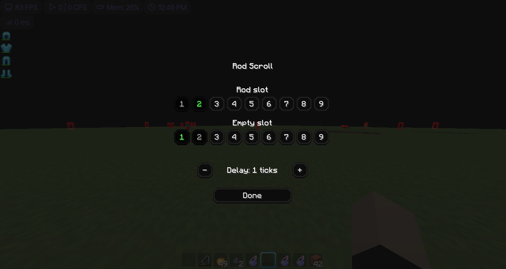
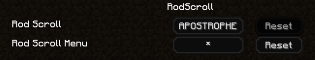

# RodScroll

Forge 1.8.9 mod that switches between a rod slot and an empty slot while you hold a key. It has an in-game menu to pick your two slots and the delay between switches.

## Screenshots

**Settings menu** (press `\`)

**Controls** (rebind under Options > Controls > RodScroll)

## Usage

1. Install Forge 1.8.9 (11.15.1.2318).
2. Put `rodscroll-1.0.jar` in your `mods` folder.
3. In a world, press `\` to open the menu and choose your rod slot, empty slot, and delay.
4. Hold `'` to use it. Nothing happens if the rod slot has no fishing rod in it.

Settings are saved in `config/rodscroll.cfg`.

## Build

Needs JDK 8. Run this from the project folder:

    ./gradlew build

The jar ends up in `build/libs/`.

## Note

Intended for singleplayer and servers that allow it. Check the rules of any server before using it.

## License

MIT, see `LICENSE`.
